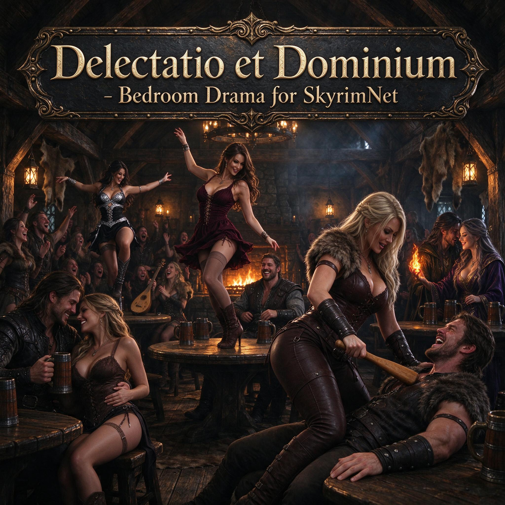

Delectatio et Dominium
======================

  

**Bedroom drama for SkyrimNet.**
*NPCs who flirt, grab, fight, pose, mark, rob and spare you — because the AI decided they would.*

`83 AI actions` · `63 narration triggers` · `SexLab and OStim` · `SkyrimNet 0.25+` · `Magelight UI 1.9+`

> ⚠️ **Adult content (18+).** DeD adds sexual, non-consensual and violent roleplay themes. Read the
> [disclaimer](#disclaimer) before installing.

**Important:** every DeD menu runs on **[Magelight UI](https://www.nexusmods.com/skyrimspecialedition/mods/193303) 1.9.0 or newer**
(a separate download). PrismaUI is no longer used.

**Upgrading from 0.4.x?** 0.6.0 retires the Acheron Bridge — **DeD Downed** replaces Acheron. Install into a
new mod folder, untick `SkyrimNet_AcheronIntegration.esp`, and read [Upgrading](#upgrading-from-04x) first.

Contents: [What's new](#whats-new-in-060) · [Overview](#overview) · [Features](#features) ·
[Installer options](#installer-options) · [Requirements](#requirements) · [Compatibility](#compatibility) ·
[Installing](#installing-and-upgrading) · [Settings](#settings) · [Troubleshooting](#support-and-troubleshooting) ·
[Credits](#credits) · [Disclaimer](#disclaimer)

* * *

What's new in 0.6.0
-------------------

**0.6.0 "Beaten, Not Dead"**
- **DeD Downed replaces Acheron:** losing a fight downs you instead of killing you, and the winners decide what
  happens next — robbery, threats, humiliation, a scene, or worse — before you come to somewhere nearby.
- **You decide what the AI may choose:** every outcome has a Never-to-Very-often setting, and the AI's choices are
  weighted by them.
- **Your companions fight on:** they can heal you back into the fight, help you up after a win — or take
  advantage, if you allow it.
- **Talk them down:** enemies you beat can be persuaded to stand down for good.
- **Restraints, robbery and a real "after":** wounds that last until you sleep, stolen gear you can win back.

**0.5.0 "The DeD Menu"** (never released publicly; included in 0.6.0)
- **One menu for everything:** a single DeD Interact power (or hotkey) opens a combined menu for every module.
- **Tattoos and makeup, done properly:** pick, queue and apply marks, preview them on the body, and give every
  tattoo a description the AI can read.
- **Scenes hand off** to [SkyrimNet-SexLab Integration](https://github.com/GoodProvider/SkyrimNet_SexLab) or [OStimNet](https://github.com/tetherball88/OStimNet) for their scene picking.
- **Spank during a scene** with its own hotkey.

Full details: [Releases](https://github.com/regalrascal/Delectatio-et-Dominium/releases) and the [CHANGELOG](CHANGELOG.md).

* * *

Overview
--------

Delectatio et Dominium (DeD) is a **modular SkyrimNet integration for classic adult Skyrim mods**. The LLM driving
your NPCs doesn't just know what is happening — it reacts as the character would, narrates it in-story, and decides
what happens next. Often DeD drives the mods itself: it starts paired animations and scenes, applies tattoos and cum
decals, and downs the loser of a fight.

It is built as a **framework plus modules**: each module is a separate installer option, nothing requires another
module, and every cross-module feature switches itself on only when both sides are installed. It supports **both
SexLab and OStim** — pick either, or run both.

**Nothing fires at random:** every interaction, pose and outcome is decided by SkyrimNet's model, in context, from the
characters' personalities — and every one of them can be dialled down or switched off.

* * *

Features
--------

### The DeD menu
- **One power, one menu:** cast **DeD Interact** (or press the **Open DeD** key) at anyone — or no one — and the
  combined menu opens on what makes sense: interactions, poses, tattoos, the downed menu, or a grapple mid-combat.
  ***DeD Interact is a minor power in your magic menu.***
- **Every module in one place:** each installed module adds its own section, with its own settings tab.
- **Settings where you play:** most module settings live inside the menu; the MCM keeps the keys, the version and
  the global switches.
- **During a scene:** the power (or the **Spank** key) spanks your scene partner — with a picker when there are
  several — and leaves spank marks with SlaveTats installed.

### Baka Interactions — the interaction core
- **Paired interactions:** hugs, kisses, flirting, arm holds, gropes, harassment and more — affectionate, forced and
  sexual, in three menu tabs, and as AI actions NPCs choose themselves.
- **Escalation with resistance:** grabs, chokeholds and struggles with a QTE; the victim can resist, submit, call for
  help or break free, and the AI plays it out.
- **The encounter wizard:** when a scene starts with you, pick who takes whom, how, the circumstance and the act.
- **Capture and captivity:** tie up, strip, inspect, choke down or execute the defeated; sell to slavery (SS++) or
  enslave a follower (FSM).
- **Creatures:** hostile creatures can be drawn into the same lanes (opt-in, needs creature animations).
- **Everyday moments:** sit on someone's lap, facial expressions on cue, and a set of quick poses (kneel, drink,
  scratch your head, dogeza…).
- **Cum, narrated:** applied cum becomes part of the story — who applied it, how characters deal with it — with a
  choice of decal source (OCum, SexLab, SLACS 2 + SCO) and a status page in the menu.

### Scenes — SexLab and OStim
- **Either framework, or both:** DeD starts scenes on whichever you run (the MCM picks Auto).
- **Hand Off Scene Setup** (on by default): scenes go through **[SkyrimNet-SexLab Integration](https://github.com/GoodProvider/SkyrimNet_SexLab)** or **[OStimNet](https://github.com/tetherball88/OStimNet)** when
  installed, so their own scene choice and settings apply.
- **Richer scene starts:** the narration says who, how and why, from the choices made.

### DeD Downed — beaten, not dead (new in 0.6.0)
- **Downed instead of killed:** the player, companions and everyone else can be downed by a lethal blow, each with
  its own chance.
- **The downed menu** (with Baka Interactions): Help Up (costs a health potion in a fight), Talk, Execute with a
  kill move for your weapon, and Baka's other downed actions. Healing a downed person with a spell or potion gets
  them up too.
- **When you lose:** the winners each decide what to do with you and your downed companions — rob you, threaten
  you, start a scene (alone or as a group), strip, tattoo or paint you, or leave. **You set how often each happens**,
  from Never to Very often, and whether they stop after one thing or keep going.
- **Robbery you can undo:** they take gold and an item; it is in their inventory if you hunt them down.
- **The "after":** the screen fades, time passes, you come to somewhere nearby with a narration — and, if you like,
  **Wounded** until you sleep (less health and stamina, slower regeneration, shown in your active effects).
- **Your companions:** they fight on and may heal you back into the fight; after a win they help you up — or, if you
  allow it, take advantage. If you prefer, they surrender with you.
- **Enemies you beat:** they stay down, then too hurt to fight; talk to them, and when they recover they may decide
  to stand down for good. An aggressive scene puts them back on the ground.
- **Restraints:** give a downed captive restraints (Devious Devices or any listed keyword) and they stay restrained;
  Baka's Tie Up holds them down for its hours.
- **Works with Acheron installed:** switch Acheron off in its MCM (DeD Downed takes over) or remove it after the
  MCM's **Prepare to Remove Acheron**.

### Ambient life — the daedric modes
- **Mephala and Molag Bal** (Baka): dominant NPCs escalate on their own initiative, from flirtation to force.
- **Sanguine and Sheogorath** (GS Poses): NPCs strike mood-fitting poses on their own; Sheogorath makes the room
  livelier.
- **Two-stage decisions:** each mode reads the room first, then picks subject, target and act with a one-line motive,
  in its own voice.
- **Reaction lanes:** each moment can land as scene narration, nearby NPCs' thoughts, words aimed at you, or your own
  thoughts — each on its own switch, with cadence sliders and a Narrative or Random selection per mode.

### GS Poses — solo posing
- **The pose grid:** 19 pose categories for you or any NPC, and AI pose actions (dance, seduce, plead, present,
  stretch, work out…).
- **Pose cues written as prose:** different lines when someone is watching, and natural stop lines.
- **Gender policy:** female-only, curated, or all poses.

### SlaveTats — marks that linger
- **Tattoos and makeup from the menu:** on yourself, on a downed captive, or on someone who agreed to it; queue
  several and apply them together.
- **Live preview:** see the marks on the body before applying (with [Phantasm](https://www.nexusmods.com/skyrimspecialedition/mods/197470) installed).
- **Descriptions the AI can read:** write your own, or let DeD describe a tattoo from its texture, so NPCs know what
  a mark says and where it is.
- **AI actions:** NPCs tattoo, brand or paint others in character, and react to marks they notice.
- **Packs found automatically:** every installed tattoo pack shows up, with toggles to hide the ones you don't want.

### Fill Her Up — inflation with a voice
- **Narrated inflation:** swelling on level-up, release on level-down, creature fills, with ambient follow-ups.
- **OStim drives its own fills;** no SexLab bridge needed.

### Safety and control
- **A hard boundary:** no DeD action of any kind ever targets an engine-marked child, regardless of any setting.
- **Panic Reset:** one button that clears every stuck hold and restores your controls.
- **Everything is switchable:** master and per-module toggles, intensity sliders, and every ambient cadence.

* * *

Installer options
-----------------

| Option | Ticked by default | What it adds | Needs |
|---|---|---|---|
| **Framework** | always installed | DeD Service, the DeD menu, the MCM, the DeD Interact power | [Magelight UI](https://www.nexusmods.com/skyrimspecialedition/mods/193303) |
| **Baka Interactions** | yes | Interactions, escalation, capture, creatures, Mephala / Molag Bal, cum narration, spank packs | Baka Motion Data Pack |
| **GS Poses** | yes | The pose grid, pose actions, Sanguine / Sheogorath | GSPoses |
| **FHU Inflation** | when FHU is found | Inflation narration | Fill Her Up — Baka Edition |
| **SlaveTats** | when SlaveTats is found | Tattoos, makeup, descriptions, the tattoo section | SlaveTats |
| **DeD Downed** | yes | Downs instead of deaths, the encounter, robbery, companions, parley | — |

Each module is inert without its prerequisite: its settings grey out and it does nothing rather than breaking.

* * *

Requirements
------------

| | |
|---|---|
| **Required** | Skyrim SE 1.5.97 or AE 1.6.x · [SKSE64](https://skse.silverlock.org/) · [SkyrimNet](https://github.com/MinLL/SkyrimNet-GamePlugin) 0.25 or later · [Magelight UI](https://www.nexusmods.com/skyrimspecialedition/mods/193303) 1.9.0+ · [SkyUI](https://www.nexusmods.com/skyrimspecialedition/mods/12604) · [PapyrusUtil](https://www.nexusmods.com/skyrimspecialedition/mods/13048) · [Baka Motion Data Pack](https://www.loverslab.com/files/file/26992-baka-motion-data-pack/) (run Pandora / Nemesis / FNIS) |
| **Scenes (at least one)** | [SexLab Framework](https://www.loverslab.com/files/file/20058-sexlab-se-sex-animation-framework-v166d-08292026/) · OStim Standalone. Without either, escalation simply won't start a scene. |
| **Per module** | [GSPoses by Gunslicer](https://www.patreon.com/Gunslicer/posts/pose-mod-02-06-159933025) (GS Poses) · [Fill Her Up — Baka Edition](https://www.loverslab.com/files/file/14920-fill-her-up-baka-edition/) (FHU) · [SlaveTats](https://www.loverslab.com/files/file/619-slavetats/) + JContainers (SlaveTats; [SlaveTats NG](https://www.loverslab.com/files/file/35989-slavetatsng/) recommended) |
| **Recommended** | [SkyrimNet-SexLab Integration](https://github.com/GoodProvider/SkyrimNet_SexLab) or [OStimNet](https://github.com/tetherball88/OStimNet) (scene hand-off) · an arousal framework (OSL Aroused or SL Aroused NG) · [Flash Games – Struggling QTE](https://www.nexusmods.com/skyrimspecialedition/mods/121909) · [Injured Animations Dynamic Replacer SE](https://www.nexusmods.com/skyrimspecialedition/mods/34663) (the injured look for beaten enemies) · [SeverActions](https://github.com/Severause/SeverActions) |
| **Optional** | [OCum](https://www.nexusmods.com/skyrimspecialedition/mods/77506) or SLACS 2 + SCO (cum decals) · [Phantasm](https://www.nexusmods.com/skyrimspecialedition/mods/197470) (tattoo live preview) · Devious Devices (restraints) · [OCreatures Revived](https://www.loverslab.com/files/file/49059-ocreatures-revived/) + creature animations · [SS++](https://www.loverslab.com/files/file/13531-simple-slavery-plus-plus/) (Sell to Slavery) · [FSM](https://www.loverslab.com/files/file/23032-follower-slavery-mod-fsm-14122025/) (Enslave Follower) · [EmoTears](https://www.nexusmods.com/skyrimspecialedition/mods/122296) · [Dynamic Feminine Female Modesty Animations OAR](https://www.nexusmods.com/skyrimspecialedition/mods/104374) |
| **No longer needed** | PrismaUI (since 0.5.0) · Acheron (since 0.6.0) |

**Game versions:** SE 1.5.97 and AE 1.6.x are tested in-house. The DLLs use Address Library, so 1.7 with matching SKSE
should load, but is untested. **VR** is not supported yet: the DLLs load on VR, but the menus and keys have not been
tested there.

* * *

Compatibility
-------------

| Mod | How DeD works with it |
|---|---|
| **Acheron** | Replaced by DeD Downed. If it stays installed, switch it off in its own MCM; DeD Downed waits until you do. |
| **Death alternatives** (e.g. Respawn) | DeD Downed acts before them; when its roll says "not this time", they run as before. |
| **Press E to Heal Followers** | No double potion: DeD's downs don't use the engine bleedout, so only DeD's Help Up applies to them. |
| **[SkyrimNet-SexLab Integration](https://github.com/GoodProvider/SkyrimNet_SexLab) / [OStimNet](https://github.com/tetherball88/OStimNet)** | Scenes hand off to them (setting Hand Off Scene Setup). |
| **SeverActions** | Works alongside; its downed and captive actions add to the AI's options. |
| **Devious Devices** | Restraints given through DeD Downed are recognised; locked devices stay on without their key. |

* * *

Installing and upgrading
------------------------

### New install
1. Install the requirements (SkyrimNet first, then Magelight UI).
2. Install DeD with Mod Organizer 2 and pick your modules in the installer.
3. Run **Pandora / Nemesis / FNIS**.
4. Start the game, open the **Delectatio et Dominium** MCM once, and cast **DeD Interact** (or bind **Open DeD**).
5. In SkyrimNet's dashboard, check that the `regalrascal.*` content packs are listed.

### Upgrading from 0.4.x
- **Install into a new mod folder** and disable the old one; untick `SkyrimNet_AcheronIntegration.esp`.
- **Acheron:** keep it switched off in its MCM, or use **Prepare to Remove Acheron** (DeD MCM → Acheron page), save,
  then remove it. DeD Downed clears the old bridge state on the first load.
- **PrismaUI** can be removed.
- An old save that used the bridge may log Papyrus errors about its missing scripts: harmless, nothing runs.

* * *

Settings
--------

- **In the DeD menu:** each module's **Settings** tab (and the menu-wide Settings at the bottom of the rail) holds
  almost everything — interaction behaviour, the daedric modes, tattoo options, DeD Downed's outcomes and timers.
- **In the MCM (Delectatio et Dominium):** the version, the **Open DeD** and **Spank (in a scene)** keys, master
  switches, Panic Reset, and the Acheron page while Acheron is installed.

* * *

Support and troubleshooting
---------------------------

**Someone is stuck down or can't fight:**
- **Help them up** from the downed menu (a health potion in a fight), or heal them above a third of their health.
- **Wait it out:** downs and "too hurt to fight" end on their timers (1–10 minutes, in DeD Downed's settings); a wait
  or sleep clears them.
- **Panic Reset** (MCM → Settings) clears every stuck hold and restores your controls. Always safe to press.

**The menu doesn't open:** check Magelight UI 1.9.0+ is installed and active, and that the DeD Interact power is in
your powers list.

**Reporting a problem:** describe what happened and attach the logs — the SkyrimNet log, `DeDService.log` and
`DeDDowned.log` (in `Documents\My Games\Skyrim Special Edition\SKSE\`), and the Papyrus log. A report with logs is
worth ten without.

**Honest state:** DeD is tested in-house as far as one person can. Expect rough edges; testing, feedback and logs are
what harden it.

* * *

Credits
-------

- **Around906** — original author of SkyrimNet Animations — GS Poser, SkyrimNet Baka Integration and SkyrimNet Acheron
  Integration, the work this project started from. DeD began as a consolidation and re-release of those mods, with his
  permission and his generous full-takeover grant (2026-10-07 / 2026-10-12). It has grown a long way since — new
  modules, menus and systems — but the lineage is his, and this project would not exist without him.
- **Oldcustard** — bug hunting, the creature-struggle fixes and Execute contributions.
- **Gunslicer** (GSPoses) and **Baka** (Baka Motion Data Pack, Fill Her Up — Baka Edition) — the source mods DeD builds on.
- **Min and the [SkyrimNet](https://github.com/MinLL/SkyrimNet-GamePlugin) project** — the framework this whole mod lives inside.
- **The authors of [Magelight UI](https://www.nexusmods.com/skyrimspecialedition/mods/193303), [SkyrimNet-SexLab Integration](https://github.com/GoodProvider/SkyrimNet_SexLab), [OStimNet](https://github.com/tetherball88/OStimNet), [Phantasm](https://www.nexusmods.com/skyrimspecialedition/mods/197470), Acheron and SeverActions** — whose work DeD
  builds on, hands off to, or learned from.

* * *

Disclaimer
----------

> I realize some of the content in these modules is fairly extreme. While I can't and
> don't judge what roleplay my fellow gamers want to pursue in their sessions, I want to
> make clear that these theme explorations are only acceptable because they are happening
> in a harmless environment of code and animation. The game represents an environment
> where the users agree with themselves, as adults, to explore, roleplay, and visualize
> these themes, as if they were writing a story for themselves on the topic. The content
> of this roleplay is not meant to be shared or to produce content for anyone else, and
> the whole process is built to be consensual by definition. The existence of these
> modules and the themes they cover are in no way meant to encourage or normalize this
> kind of behavior in the real world. They exist in this mod because their moral
> repugnancy and cultural taboo shock, thrill, and horrify in the same way they would in
> a TV show, or movie. I will belabor the point no more, but I hope it is well made.
> Enjoy the mod for what it is, and do not take it as an endorsement for real sexual
> violence or illegal activaties.

*(Disclaimer text by the project's author, transcribed verbatim.)*

License
-------

MIT — see [LICENSE](LICENSE).
